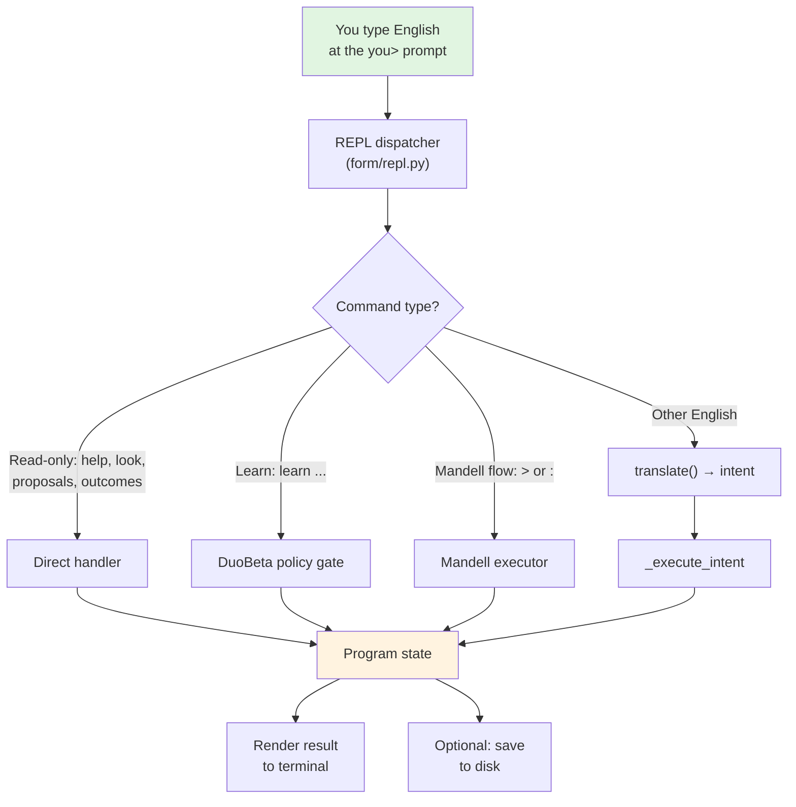
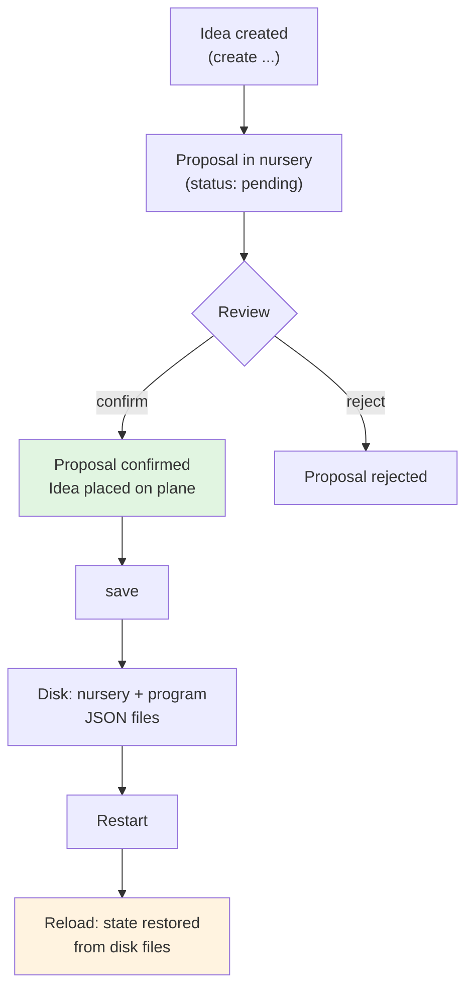

> STATUS: IN USE — describes live code in form/ at commit 11933da. Doc verified against code 2026-10-30.

# DellMatrix

**An offline idea environment with a structured language for working with thoughts.**

DellMatrix lets you create ideas, grow them into proposals, confirm the ones worth keeping, inspect how they relate, and save everything to disk — all through plain English commands in a terminal, with no network required.

> **Scope honesty:** This README describes what the code at the reviewed production SHA actually does, based on executed walkthroughs. Section 2 lists exactly what is working, partial, in repair, or planned. Nothing here claims more than the evidence supports. Full source/evidence map: [docs/README_EVIDENCE_MAP.md](docs/README_EVIDENCE_MAP.md).

---

## 1. What DellMatrix Is

**Mandell** is a structured language of operators ("Dells"), flow, and math/nature patterns. It is designed to be readable by people and executable by machines — a bridge language for human-computer collaboration.

**DellMatrix** is the host environment that runs Mandell. It provides:

- **An idea workspace** — create ideas, give them words, detail, and goals
- **A nursery** — grow ideas into proposals, review them, confirm or reject
- **A plane** — confirmed ideas become visible "units" you can inspect spatially
- **Persistence** — save your work to disk, reload it later, recover from crashes
- **Learning hooks** — DuoBeta observation and policy-gated learning
- **Visual export** — generate an offline HTML view of your idea space

**Present runtime vs. planned vision:** Today DellMatrix is a working terminal-based idea environment (see §2). Parts of the long-term vision are now implemented and verified: projects as named groups, interchangeable perspectives, cross-session learning, and an interactive visual layer. What remains planned (deep group-in-group nesting, candidate connections) is labeled PLANNED in §2 and §7, not described as implemented.

---

## 2. Status

**Production main:** `11933da` (2026-10-30, post PR #155 merge — full 100-Dell registry proof circuits complete).
**Phase 5:** MERGED to production via PR #79 (merge `ea9b76a`); Director admission PASS.
**Phase 6:** R6.1–R6.5 MERGED/CLOSED.
**Phase 7:** R7.1 MERGED via PR #85 (Director admission PASS); R7.2–R7.7 MERGED via PRs #87–#92 (independent/Director certification outstanding — merged is not certified).
**Post-GDP capability phases A–E:** MERGED via PRs #95–#99 (dock transport, interaction lookup, InternetGate hardening, KIE routability, action provenance).
**README Completion Program H–O:** MERGED via PRs #100–#107 (lineage by label, resonance commands, DuoBeta cross-session, Spanish/French, launchers, projects, visual UX, README truth reconciliation).
**Phase F (replication):** MERGED via PR #108 — `form.regress --passk ENTRY K` re-runs a suite K times on fresh tree copies; green only at k/k.
**Ten-Phase Master Plan P1–P12:** MERGED via PRs #109–#120 (dedup + baseline closure, evidence integrity, surface wiring, the semantic-docking program SD-1..SD-5 as P4–P8, Exchange v1 as P9, flow-grammar conformance as P10, satellite disposition as P11, final audit + closure as P12).
**Post-plan packets PP1–PP5:** MERGED via PRs #122–#124 and #126–#128 (stopwords, autonomy charter, unknowns, docked Bimo configuration, flow visuals). **Exchange residual repair:** MERGED via PR #125.
**Director Mode D review (2026-10-28):** 29 of 31 segments certified with noted exceptions. The Exchange segment (PR #117 line) and the P12 audit segment (PR #120 line) were declined; the Exchange residual repair is merged (PR #125) and both await Director re-ruling. Merged is not certified.
**D1 deep-contract circuits + full-registry proof:** MERGED via PRs #129–#155 — per-Dell circuits for the typed set plus reconciliation repairs R1–R5 (PRs #129–#148), then registry circuits 16–22 completing proof cards for all 100 Dells (PRs #149–#155). Merged, not certified.

All §2 table rows below were verified on or before production main `c6fd2fb`
(2026-10-27) unless labeled otherwise; the phase-status lines above are current
at production main `11933da` (2026-10-30). Walkthroughs originally executed on `f3c9007`
(2026-10-04) are retained as dated historical evidence where noted.
Phase-5 behaviors (§6.7) are production behavior as of `ea9b76a`.

| Area | Status | Evidence |
|------|--------|----------|
| REPL launch (`python launch.py`, `python3 -m form.repl`) | **WORKING / VERIFIED** | Launched, `you>` prompt, EOF exits cleanly |
| Create idea (`create an idea called X`) | **WORKING / VERIFIED** | Idea created with coaching on strength/detail/goals |
| Grow ideas (`grow ideas N`) | **WORKING / VERIFIED** | Proposals generated in nursery |
| Review proposals (`proposals`) | **WORKING / VERIFIED** | Lists pending proposals with IDs |
| Confirm (`confirm <id>`, `confirm all`) | **WORKING / VERIFIED** | Proposal confirmed, Idea placed on plane |
| Inspect (`look`, `page`, `rank`) | **WORKING / VERIFIED** | Affinity-ordered display, lineage shown |
| Shapes (`sphere`, `lattice`) | **WORKING / VERIFIED** | Skin/form change, grid render |
| Save / reload (`save`, `--load`) | **WORKING / VERIFIED** | Files written, state survives restart |
| Visual export (`visual`) | **WORKING / VERIFIED** | Offline HTML file generated; interactive (see Rich visual UX row) |
| Tutorial (`tutorial`) | **WORKING / VERIFIED** | Walks the acceptance path |
| Help (`help`, 9 categories) | **WORKING / VERIFIED** | create, knowledge, learn, explain, save, recover, look, dell, system |
| DuoBeta learn (`learn propose/inspect/gate/ledger`) | **WORKING / VERIFIED** | Real policy gating within session |
| Python API (`open_program`, `confirm_proposal`, `persist_rest`, `supersede_proposal`) | **WORKING / VERIFIED** | Direct API calls tested |
| Offline operation | **WORKING / VERIFIED** | No network calls in tested paths; stdlib-only core deps |
| Resonance/harmony commands | **WORKING / VERIFIED** | Direct user commands `resonance`, `resonance <id or label>`, `harmony` over canonical active nodes (Phase I, PR #101; `resonance_command_test` 17/17) |
| DuoBeta cross-session learning | **WORKING / VERIFIED** | Full lifecycle across separate OS processes — execute, `save`, restart `--load`, propose, gate, apply — proven by `duobeta_cross_session_test` 21/21 (Phase J, PR #102). Persistence is via explicit `save`/`load`; a plain start is a fresh in-memory program |
| REPL `supersede` command | **WORKING / VERIFIED** | `supersede idea <id> with <words>` works with genuine confirmed ID; fails gracefully on unknown/non-confirmed ID |
| `lineage` by label | **WORKING / VERIFIED** | `lineage <id or label>`: exact ID, exact label, or case-insensitive label; multiple distinct matches report ambiguity honestly (Phase H, PR #100) |
| Confirmation atomicity | **WORKING / VERIFIED** | Intent-journal recovery merged via [PR #77](https://github.com/spiritualityhandbook-netizen/DellMatrix/pull/77) (2026-10-05); crash converges to complete OLD or NEW state |
| Perspectives | **WORKING / VERIFIED** | Plane perspective/zoom persisted; R7.1 `compose_views`; R7.2 Perspective Studio (§7.5) |
| Projects (named groups) | **WORKING / VERIFIED** | A project is a named Plane sandbox group: `groups`, `group create/add/remove/show/delete`; membership scopes enhancement within the group (Phase M, PR #105). Group-in-group nesting is NOT implemented |
| Rich visual UX | **WORKING / VERIFIED (scoped)** | Snapshot export is interactive offline: click-to-inspect + filter/search; the page's script is verified by executed DOM-logic tests (`visual_ux_test` 17/17, Phase N, PR #106). Live bridge is interactive on localhost, verified at HTTP level. Pixel rendering in a named commercial browser was not executed in the build environment |
| Connected inference (`connect`) | **WORKING / VERIFIED (scoped)** | Public connect path runs the dock over real HTTP, proven against a local provider-shaped double (Phase A, PR #95); dock output lands as pending proposals with origin stamps (Phase E, PR #99). A live third-party provider run was not executed in the build environment |
| Outcome interaction lookup | **WORKING / VERIFIED** | `outcomes interaction <seq>` resolves a recorded interaction by sequence (Phase B, PR #96) |
| Knowledge routability (KIE) | **WORKING / VERIFIED** | Stored knowledge completes the eligibility → selection → routing path under the hard laws (Phase D, PR #98) |
| InternetGate posture | **WORKING / VERIFIED** | Auto-enable hardened off by default; external access fails closed (Phase C, PR #97) |
| Windows/Mac launchers | **PARTIAL (split)** | Mac `Launch DellMatrix.command`: **VERIFIED** — executed end-to-end in a terminal; executable bit fixed (Phase L, PR #104). Windows `Launch DellMatrix.bat`: present and structurally verified; NOT executed (no Windows environment available) |
| Spanish/French commands | **WORKING / VERIFIED** | `es`/`spanish` and `fr`/`french` run the core loop; language maps at exact parity (41 intents each); unmapped phrases answer honestly and execute nothing (Phase K, PR #103) |
| Dock provenance (SD-1) | **WORKING / VERIFIED** | Every docked proposal carries a full origin stamp (`dock:<subject>:<provider>:<model>`), a non-empty reason, its session's task kind, and a persisted dock-session evidence record (prompt hash, context snapshot hash) shown at review (P4, PR #112; `p4_sd1_test` 19/19) |
| Semantic verbs (SD-2) | **WORKING / VERIFIED** | A docked AI can `relate`, `synthesize` (authored detail/goals from both parents — confirmed crosses no longer inherit only the first parent's content), and `flag`, plus read a redacted `field_snapshot`; every judgment lands as a PENDING proposal under the human gate (P5, PR #113; `p5_sd2_test` 24/24) |
| Docked growth (SD-3) | **WORKING / VERIFIED** | In connect mode, `grow` routes Solstice pair crosses through the docked AI's synthesize; token composition is the labeled fallback (`growth:token` origin) and drift stays token machinery (P6, PR #114; `p6_sd3_test` 10/10) |
| Scoped Director dock (SD-4) | **WORKING / VERIFIED** | A Director bound to one scope can review, recommend, request evidence, and file directive proposals; its accept is a recorded **recommendation, never a confirmation** — proposal status is never changed by it; out-of-scope access is refused and the refusal is recorded (P7, PR #115; `p7_sd4_test` 17/17) |
| Inside-out design loop (SD-5) | **WORKING / VERIFIED** | Docked AIs file `kind=design` proposals; the loop ledger (`design_loop` section) assembles the full chain per proposal — filed → Director recommendation → human gate → implemented (PR + merge SHA) — and the REPL review surface prints Director recommendations under proposals (P8, PR #116; `p8_sd5_test` 12/12; the first full loop turn shipped in PR #116 itself) |
| Exchange v1 | **WORKING / VERIFIED** | `exchange export <id> <file>` / `exchange import <file>`: seed packets carry receipts (guess/test/mirror/outcome); chain lint labels missing links precisely; import lands PENDING under the receiver's own gate with replication counted, never scored; authority keys in a packet are refused at the boundary (P9, PR #117; `p9_exchange_test` 11/11, cross-process two-owner proof) |
| Flow grammar | **WORKING / VERIFIED** | All nine flow operators (`> >> >>> : :: :> <: <:> <<[Delta]`) execute with the canonical chain semantics at the public REPL path — the parsed set, the contract set, and the executable set are the same set (P10, PR #118; `p10_flow_grammar_test` 12/12) |
| Regression suite | **WORKING / VERIFIED** | `python3 -m form.regress` runs 198 registered suites (LIST in `form/regress.py`); the master-plan phases each added their proof suite (159/159 green at `c6fd2fb`, forward / twice / reverse) |

---

## 3. How It Works

### (a) From English input to executed result



**Autonomy note:** Most commands require you to type them, but DellMatrix has autonomous paths with different defaults:
- `form/dell_matrix/auto_growth.py`: The `AutoGrowth` dataclass defaults to `auto=False, internet=True` (code comment: "WO-5.1: Default OFF. Automated acceptance requires explicit opt-in."). With `auto` explicitly enabled, it can automatically propose and confirm ideas based on quality thresholds (`_should_auto_confirm` returns False unless `auto` is on; then it checks `floor_accept`, `verita_score`, `combined` score, and grade). Confirmation goes through the owner Program's `confirm_proposal()`; AutoGrowth never mutates confirmation status itself.
- REPL `auto confirm on`: The `Program.auto_confirm_grow` attribute defaults to `False`. When the user types `auto confirm on`, every subsequent `grow` command automatically confirms all nursery proposals.
- Default posture: REPL interaction is human-controlled by default; the `AutoGrowth` class is opt-in (defaults off) even when instantiated directly.

### (b) Proposal lifecycle and persistence



The nursery tracks proposal status (`pending` → `confirmed`). The plane holds confirmed Ideas as spatial units. On `save`, both are written to disk. On restart, `load` restores state from the disk files.

**Crash recovery (MERGED via PR #77, 2026-10-05):** If the process crashes mid-confirmation, the intent-journal recovery mechanism converges to either the complete OLD state or the complete NEW state (not necessarily the exact pre-crash state). This is production behavior on current main `11933da` (mechanism unchanged since PR #77).

---

## 4. Quick Start

**Requirements:** Python 3.10+, no third-party packages for the core loop (see `requirements.txt`). Tested on Linux; the Mac launcher is executed and verified, the Windows launcher is structurally verified only (see §2).

**Docs:** [INSTALL](docs/INSTALL.md) · [START_HERE](docs/START_HERE.md) · [TUTORIAL](docs/TUTORIAL.md)

```bash
# Clone and launch
git clone https://github.com/spiritualityhandbook-netizen/DellMatrix
cd DellMatrix
python launch.py YourName
```

You'll see a banner and a `you>` prompt. Type `tutorial` for a guided walkthrough, or `help` for command categories.

**Offline:** The core loop (create → grow → confirm → inspect → save) makes no network calls. Optional features under `form/llm` may need extras; they are not part of the core loop.

**Generated output:** `save` writes JSON files under `form/state/`. `visual` generates `DellMatrix_UI.html` in the repo root (a generated, git-ignored output file, not a tracked deliverable).

---

## 5. Capabilities

| Action | User entrypoint | Observable result | Implementation source | Test |
|--------|----------------|-------------------|----------------------|------|
| Create idea | `create an idea called <name>` | Idea stored; coaching on strength/detail/goals | `form/repl.py`, `form/dell_matrix/` | Walkthrough verified |
| Grow proposals | `grow ideas N` | Proposals in nursery (count varies; observed 1 from `grow ideas 2`) | `Program.grow_ideas` in `form/open.py` (`form/grow.py` is the self-grow entry shim to `form/duobeta/selfgrow`) | Walkthrough verified |
| List proposals | `proposals` | Pending proposals with IDs | `form/dell_matrix/nursery.py` | Walkthrough verified |
| Confirm | `confirm <id>` / `confirm all` | Proposal confirmed; Idea on plane | `form/dell_matrix/confirm_lineage.py` | Walkthrough verified |
| Inspect | `look`, `page`, `rank` | Affinity-ordered idea display | `form/dell_matrix/first_person.py` | Walkthrough verified |
| Lineage | `lineage <proposal-id or label>` | Ancestry/derivation shown | `form/dell_matrix/lineage.py`, `form/mandell/runtime_observe.py` | Verified by ID and by label |
| Shapes | `sphere`, `lattice` | Visual form change + grid | `form/dell_matrix/` spatial | Walkthrough verified |
| Save / reload | `save`, `python3 -m form.repl --load` | JSON files; state survives restart | `form/persist.py`, `form/persist_rest.py` | Walkthrough verified |
| Visual export | `visual` | `DellMatrix_UI.html` generated (interactive offline) | REPL `visual` handler | File verified; script verified by executed DOM-logic tests; browser pixel rendering not executed in build environment |
| Resonance / harmony | `resonance`, `resonance <id or label>`, `harmony` | Ranked resonance candidates / harmony view over active nodes | `form/mandell/runtime_observe.py` | Verified (`resonance_command_test`) |
| Projects (groups) | `groups`, `group create/add/remove/show/delete` | Named group created; members listed; enhancement scoped to group | `form/dell_matrix/plane.py` (Sandbox), REPL group handler | Verified (`projects_groups_test`) |
| Tutorial | `tutorial` | Guided acceptance path | `form/repl.py` | Walkthrough verified |
| DuoBeta learn | `learn propose/inspect/gate/ledger` | Policy-gated learning within session | `form/duobeta/` | Walkthrough verified |
| Supersede (API) | `supersede_proposal(p, old_id, ...)` | New revision; old marked superseded | `form/mandell/supersession.py` | API and REPL both verified with genuine ID |
| Outcomes | `outcomes` | Honest empty ("No outcomes recorded") or list | `form/repl.py` | Walkthrough verified |
| Compose perspectives | `compose_views(program, [(viewer, mode), ...])` | Unified read-only view; each component attributed with viewer/mode/status | `form/dell_matrix/perspective_views.py` | R7.1 52/52, MERGED |
| Dock + semantic verbs | `connect` mode `ask`; API `DockedSession.propose/relate/synthesize/flag` | PENDING proposals with origin stamps, reasons, and persisted dock-session evidence | `form/dell_matrix/inference_dock.py`, `form/dell_matrix/dock_session.py` | `p4_sd1_test`, `p5_sd2_test` |
| Director review | API `bind_director_endpoint`; shown in `proposals` review | Scoped recommendations recorded (never confirmations); printed under the proposal at human review | `form/dell_matrix/director_session.py`, `form/dell_matrix/design_loop.py` | `p7_sd4_test`, `p8_sd5_test` |
| Exchange | `exchange export <id> <file>`, `exchange import <file>` | Packet file with receipts; import lands PENDING with replication counts + lint labels | `form/dell_matrix/exchange.py` | `p9_exchange_test` |
| Flow chains | Seed lines with any of the 9 flow operators | Canonical chain semantics (gating, skip-to-Join, context/route binding, delta checkpoints) | `form/mandell/chain_exec.py`, `form/mandell/control_runtime.py` | `p10_flow_grammar_test`, `cac_i_test` K |

> Removed in the master plan (recorded, not silently): the `form/trading/` sandbox package, the `network_main`/`shared_main` sync island, and `plant_to_dev` (P11, PR #119); a dormant free-matrix cluster (P8, PR #116). `form/ancient/` is archived in place with a pointer README.

> A module's existence is not proof of usable integration. Every row above was verified by actually running the command or API call. Historical walkthroughs (2026-10-04) ran on SHA `f3c9007`; current production is main `11933da` (2026-10-30).

---

## 6. Walkthroughs

> **Historical evidence (2026-10-04):** Each walkthrough below was executed on SHA `f3c9007` with a temporary owner; state was cleaned up afterward. REPL sessions used piped stdin. These remain valid as historical evidence of the production behavior at that SHA. The Phase-5 candidate they predate has since merged (PR #79); capabilities proven later carry their own dated evidence in §2.

### 6.1 Create, store, reload

```
you> create an idea called my first thought
# → Idea created. Coaching: add detail: and goals: for strength.

you> save
# → State written to form/state/

# Restart: python3 -m form.repl --owner <name> --load
# → Idea present after reload. VERIFIED.
```

### 6.2 Propose, review, confirm

```
you> grow ideas 3
# → 3 proposals in nursery.

you> proposals
# → Lists: <id1>, <id2>, <id3> (copy an ID)

you> confirm <id1>
# → Proposal confirmed; Idea placed on plane.

you> look
# → Confirmed Idea visible. VERIFIED.
```

**How to obtain proposal IDs:** Run `proposals` first; the output lists IDs. Pass one to `confirm`. `confirm all` confirms everything pending.

### 6.3 Inspect relationships

```
you> lineage <proposal-id or label>
# → Shows derivation/ancestry for that proposal. VERIFIED by ID and by
#    label (exact or case-insensitive; ambiguous labels list candidates).

you> rank
# → Ideas ordered by affinity. VERIFIED.
```

### 6.4 Resonance / harmony candidates

Resonance and harmony are direct user commands (Phase I, PR #101), computed over canonical **active** nodes only (superseded/excluded records never appear):

```
you> resonance
# → Ranked resonance candidates for the current center. VERIFIED.

you> resonance <id or label>
# → Resonance view centered on that node. VERIFIED.

you> harmony
# → Harmony view of the current candidate set. VERIFIED.
```

The underlying scoring machinery (`resonance_rank`, affinity) also drives `rank`/`page` ordering:

```python
# Python API - complete executable example:
from form.dell_matrix.first_person import resonance_rank
nodes = [
    {"id": "idea1", "x": 1.0, "y": 2.0, "f": 0.0},
    {"id": "idea2", "x": 5.0, "y": 5.0, "f": 1.0},
]
ranked = resonance_rank(nodes, center=(0, 0, 0), scores={"idea1": 0.9, "idea2": 0.5})
# → Returns scored candidates ordered by resonance. idea1 ranks higher (closer + higher score).
assert ranked[0]["id"] == "idea1"
```

### 6.5 Supersession and history

Supersession (replacing a confirmed idea with a newer revision) works via both the Python API and the REPL command (with a genuine confirmed proposal ID):

> Supersession requires explicit authorization (human opt-in or approval) — production behavior since PR #79.

```python
# VERIFIED working on production (Python API) - complete end-to-end:
from form.open import open_program
from form.mandell.supersession import supersede_proposal
p = open_program("Owner")
p.acceptance_policy.grant_opt_in("Owner", scope="supersede")  # Phase-5: explicit authorization
# 1. Create and confirm the predecessor
pr = p.nursery.add('Original Idea', words='initial content')
ctx = p.make_review_context(pr.id, "Owner")
p.confirm_proposal(pr.id, _producer="Owner", _review_context=ctx)
old_id = pr.id
# 2. Supersede it (returns a receipt dict)
receipt = supersede_proposal(p, old_id, words="revised content", _producer="Owner")
assert receipt["ok"] is True
assert receipt["old_id"] == old_id
assert receipt["revision_number"] == 2
new_id = receipt["new_id"]
# → Old marked superseded; new revision active; history preserved.
```

```
you> supersede idea <id> with <words>
# → VERIFIED working with genuine confirmed ID. Fails gracefully on
#   unknown/non-confirmed ID (not a broken command).
```

*Historical note (2026-10-04): An earlier draft labeled the REPL command BROKEN based on a test with an unconfirmed ID. Retesting with a genuine confirmed proposal ID shows it works.*

History: `history` shows recent entries. Crash recovery uses intent journals to distinguish interrupted operations from historical records (production behavior, merged via PR #77 — see §2).

### 6.6 Visual output

```
you> visual
# → Generates DellMatrix_UI.html (offline, no network): an interactive
#    snapshot — click a node to inspect it, filter/search nodes by
#    label, word, skin, or id. VERIFIED file created; the page's script
#    behavior is verified by executed DOM-logic tests
#    (visual_ux_test). Pixel rendering in a named commercial browser
#    was not executed in the build environment.
```

---

## 6.7 Phase-5: Acceptance Authorization and Lifecycle Coherence

Phase 5 hardened the acceptance boundary and lifecycle interpretation.
All claims verified by executed tests (see evidence map).

**Acceptance policy** (`form/dell_matrix/acceptance_policy.py`):
- Session IDs are collision-resistant (uuid4).
- Acceptance data uses canonical JSON + SHA-256 (identity, owner, content,
  parents, goals, revision metadata). No delimiter concatenation.
- Approval issuance is recorded; a matching dict alone is not evidence.
  Forged, stale, cross-session, and revoked approvals are denied.
- Revocation is supported; retry means re-issuance after re-review.
- Commit-boundary revalidation: live permission and data hash checked
  immediately before the protected mutation.
- Supersession binds predecessor version + successor payload. The
  successor's confirmation is derived via a constrained, recorded
  relationship (not a general bypass); revoked parents invalidate
  unfinished children.

**Lifecycle** (`form/dell_matrix/canonical_lifecycle.py`):
- Acceptance, revision, participation, and projection are distinct.
- Revision validated first; faded presence never masks malformed data.
- Malformed records excluded in all contexts with explicit reasons.
- Fade/unfade preserves identity, content, acceptance, and revision links.
- Unfade/pin cannot reactivate superseded truth.

**Learning** (DuoBeta):
- Influence OFF restores baseline in all consumers.
- Learning cannot manufacture evidence, resurrect excluded candidates,
  or change accepted truth.

---

## 7. Vision (Planned)

The long-term vision — each item states its current standing:

- **Projects grouping related work** — IMPLEMENTED: a project is a named group (§2, Phase M). **Nested ideas** (ideas containing sub-ideas, group-in-group nesting) remain PLANNED
- **Preserved history** — IMPLEMENTED for the learning lifecycle: DuoBeta proposals, gates, and applications persist across sessions via explicit `save`/`load` (§2, Phase J); full revision chains are visible via `lineage`
- **Interchangeable perspectives** — IMPLEMENTED: persisted plane perspectives, `compose_views`, Perspective Studio (§7.5)
- **Richer visual layers** — IMPLEMENTED (scoped): interactive offline snapshot + localhost live bridge (§6.6, §2)
- **Candidate connections** — PLANNED: the system suggesting related ideas for your acceptance is not implemented
- **Human-controlled acceptance** — IMPLEMENTED and load-bearing: nothing is confirmed, superseded, or learned without your explicit approval

Diagrams or mock examples of PLANNED items are conceptual only. The current system (§2, §6) is the honest baseline.

---

## 7.5 R7.2: Perspective Studio (MERGED via PR #87 — not independently certified)

A scoped REPL workshop for composing perspective views and inspecting
their meaning. Read-only: the studio composes views via R7.1
`compose_views`; it cannot confirm, grant, or mutate.

**Exact syntax:**

```
studio> compose [{"id":"v1","role":"user","pos":[0,0],"facing":"E","mode":"whole"}]
Composed 1 view(s) [REAL]:
[v1/whole] status=REAL source=program
  Whole plane · 3 nodes
  skins: {...}
  · label [skin]

studio> legend
Layout legend (descriptive only):
  epistemic_status: Verification standing of the view; not accepted truth.
  observations: The attributed observation report from the compositor.
  requested_mode: The observation mode requested.
  source: Provenance of the observation data.
  viewer: Attribution: which viewer specification produced this component.

studio> leave
Studio session saved (a1b2c3d4...). Exited.
```

**Spec schema:** JSON array (max 8 entries, max 8KB). Each spec is an
object with `id` (string, required), `role` (string), `pos` ([x, y]
finite numbers, required), `facing` (N/S/E/W/NE/NW/SE/SW),
`mode` (first/third/parts/whole, optional). Malformed specs are
rejected with fixed codes. A spec carrying a non-matching `owner`
is rejected.

**While in studio** (prompt shows `studio> `): only `compose`, `legend`,
`help`, `leave` are accepted. All other commands — including `reissue`
and mutations like `confirm` — are rejected as out-of-scope before
normal dispatch. The studio gate is enforced ahead of all non-exit
input handlers.

**Protection:** Compose input is screened for protected material
(grant handles, credentials) via R6.2 utilities before reflection or
recording. Screening covers raw text, escaped sequences, and decoded
keys/values. The public `PerspectiveStudio.compose` API enforces the
same screening on structured input and on the detached result before
release — direct API callers get identical enforcement. Screening
failure rejects (fail-closed). Rejections use fixed codes; raw input
is never reflected.

**Persistence:** `leave` stages the closed session record, then saves
via the canonical save. The studio exits only after successful save.
On save failure, prior records are restored and the studio remains
active for retry. Reload restores closed records, never active mode.
One strict schema governs serialization and restoration: an absent
section is legacy, an explicit null is malformed, and malformed
records are preserved as evidence (never silently saved as valid or
discarded). EOF/quit without `leave` does NOT persist the session;
this is stated explicitly.

**Evidence bounds:** The 50 most recent commands per session are
retained (enforced during recording); at most 10 sessions are kept.
Rejected attempts are recorded with safe codes. This is a retained
window, not complete history.

---

## 7.6 R7.3: General Workshop Contract (MERGED via PR #88 — not independently certified)

All seven workshops (matrix, perspective, mandel, persona, bimo,
psalms, forces) are real scoped environments in the REPL:

```
you> workshop matrix
Entered Matrix Workshop: ...
Scoped session: only this workshop's commands run here. 'leave' saves the session and exits.
workshop:matrix> cube        ← dispatches (in scope)
workshop:matrix> confirm     ← rejected: out of scope
workshop:matrix> leave       ← session saved; exited
```

**Contract:** The scoped command set is derived from the workshop's
own registry entry (`form/dell_matrix/workshops.py`) — the menu shown
and the set enforced are one source. In-scope commands route through
the same public dispatcher as outside; a workshop grants no authority.
Out-of-scope lines (including `say`-prefixed lines and staged
reissues) are rejected before dispatch. Only one scoped environment
(the studio included) may be active at a time. Input is screened for
protected material before recording; session evidence records only
command stems and fixed result codes — never raw lines.

**Persistence:** `leave` stages the closed record, clears the active
workshop flag, then saves canonically; on save failure everything is
restored and the session is retained for retry. EOF/quit without
`leave` do NOT persist the session; this is stated explicitly.
Evidence uses the strict shared section schema: an absent section is
legacy, an explicit null is malformed, and malformed records are
preserved as evidence. Bounds: 50 commands per session, 10 sessions.

---

---

## 8. Architecture and Source Guide

| Path | Role |
|------|------|
| `form/` | **Live runtime** (Python). All imports resolve here. This is the only active code. |
| `form/repl.py` | REPL front door: `run()` starts the `you>` loop; `_dispatch_public_line` routes commands |
| `form/open.py` | `Program` class and `open_program()` — the central state object |
| `form/mandell/` | Mandell language: `translate.py`, executor, checkpoint/recovery, supersession |
| `form/dell_matrix/` | Dells, nursery, plane, spatial, lineage, persistence helpers |
| `form/duobeta/` | DuoBeta learning: observation, policy gates, ledger |
| `form/persist.py`, `form/persist_rest.py` | Disk persistence (JSON under `form/state/`) |
| `src/` | **Frozen legacy** (JavaScript). Per `src/README.md`: "Do not extend." Only historical interest. |
| `preform/` | Historical notes/docs. Zero imports from `form/`. |
| `docs/` | Documentation (large; currency varies — prefer this README for current truth) |
| `launch.py` | Root launcher → `form.repl.run()` |

**Registry note:** The canonical operator registry is `form/mandell/registry.py` — the "True Dell registry" with numbered operators (CORE_I 00-50, CORE_II 51-99). English commands route through `form/repl.py::_dispatch_public_line` → `form/mandell/translate.py::translate()` → `_execute_intent`. `form/dell_matrix/actions_registry.py` provides UI action lists (`actions_flat`, `actions_for_mode`) for visual modes, not the language operator definitions. The `help` command lists 9 categories: `create`, `knowledge`, `learn`, `explain`, `save`, `recover`, `look`, `dell`, `system`.

---

## 9. Limitations, Tests, Contributing, Glossary

### Honest limitations
- `lineage` by label reports ambiguity when several distinct records share a label; use the ID to disambiguate.
- DuoBeta persistence follows the explicit `save`/`load` contract: a plain REPL start is a fresh in-memory program and EOF does not autosave.
- The Windows launcher (`.bat`) has not been executed — no Windows environment was available; the Mac launcher is executed and verified.
- A live third-party inference provider run through the dock was not executed in the build environment; the connect path is proven against a local provider-shaped double.
- Pixel rendering of the visual export in a named commercial browser was not executed in the build environment; the page's script behavior is verified by executed DOM-logic tests.
- Group-in-group nesting (projects within projects) is not implemented; a project is one named group of units.
- R7.2–R7.7 and the Post-GDP / README-program phases are merged but have no independent (Director) certification.
- Confirmation crash recovery is production behavior (merged via PR #77).
- "User-ready" is not claimed. See §2 for the scoped status table.

### Phase 5 (merged to production)
Phase-5 acceptance authorization, lifecycle coherence, and learning bounds (§6.7) were admitted via [PR #79](https://github.com/spiritualityhandbook-netizen/DellMatrix/pull/79) (merge `ea9b76a`, 2026-10-07; Director admission PASS). The main branch described by this README **includes** Phase-5 changes.

### Test commands
```bash
python3 -m form.regress --twice        # full suite, forward, twice
python3 -m form.regress --order rev    # full suite, reverse order
```

**Phase-5 tests (on production main):** The following modules merged with Phase 5 (PR #79) and are runnable on current main:
```bash
python3 -m form.mandell.wo51_adversarial_test  # acceptance adversarial
python3 -m form.mandell.wo52_coherence_test   # lifecycle coherence
python3 -m form.mandell.d20_reference_test    # Delta-20 reference model
```

### Contributing
Issues and PRs are welcome. Please verify claims against the code before documenting them — see this README's method (§1, evidence map). Do not modify `src/` (frozen).

### Glossary
- **Dell** — a Mandell operator (a structured action like Create, Map, Grow).
- **Mandell** — the bridge language: structured operations readable by people, executable by machines.
- **Nursery** — where ideas grow into proposals awaiting review.
- **Plane** — the spatial surface where confirmed Ideas live as units.
- **Proposal** — a candidate idea in the nursery (`pending` → `confirmed`/`rejected`).
- **Supersession** — replacing a confirmed idea with a newer revision (old marked superseded, history preserved).
- **DuoBeta** — the learning subsystem: observation with policy-gated learning.
- **Checkpoint** — an atomic snapshot of program + nursery state (generation-based).
- **Intent journal** — a crash-recovery record distinguishing interrupted operations from history.
