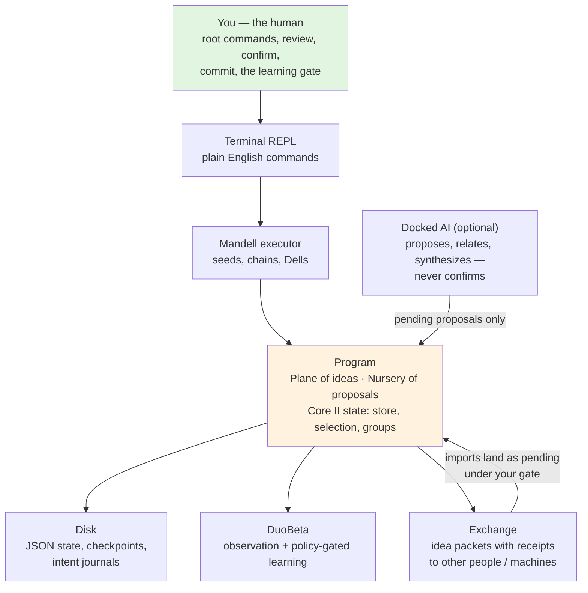

# DellMatrix

**A local-first idea environment with a structured language — Mandell — for thinking with a computer, and with AI, without losing control of what counts as true.**

DellMatrix is a working program you run in a terminal. You create ideas, grow them into
proposals, review and confirm the ones worth keeping, connect and inspect them, run small
structured programs over them, save everything to disk, and pick it up again later — offline,
with no account and no network required. An AI can be *docked* into the environment to help,
but it works under strict rules: everything it suggests arrives as a pending proposal, and
only a human confirms, commits, or teaches the system anything.

> **How to read this README.** Sections 1–6 explain the whole program — what it is, why it
> exists, every major component, and worked examples. Every example in §6 was executed
> against the code at commit `c94e223` on 2026-11-01; outputs are real, trimmed only for
> length. Sections 7–10 give status, architecture, tests, and honest limitations. DellMatrix
> is under active development: it is a real, tested, working system, and it is **not**
> claimed to be a finished consumer product.

---

## 1. Why DellMatrix Exists

Working with ideas — your own, or an AI's — has three recurring problems:

1. **Ideas evaporate.** A good thought in a chat window or a notebook margin has no address,
   no history, and no way to be built on. Next week it is gone or unfindable.
2. **AI output has no receipts.** A language model can generate fifty suggestions in a
   minute. Which ones did you actually accept? Why? What did they replace? In a normal chat,
   observation, suggestion, and fact blur together — and the blur quietly becomes "truth."
3. **Tools want your data on their servers.** Most thinking tools are cloud services. Your
   half-formed ideas — often the most valuable ones — live on someone else's machine.

DellMatrix is built around the opposite commitments:

- **Everything has an address and a history.** Ideas are named units with lineage: you can
  always ask what something came from, what replaced it, and what changed.
- **Suggestion is not acceptance.** Anything the system or an AI proposes sits in a
  *nursery* as PENDING until a human reviews and confirms it. Observation is not learning;
  storage is not truth. The program enforces that separation mechanically, not by politeness.
- **Your machine, your state.** The core runs fully offline on plain JSON files you can
  read, copy, and back up yourself.
- **A language a human and a machine can both read.** Mandell is the shared notation:
  small numbered operators with fixed meanings, so a chain of thought can be written down,
  re-run, tested, and argued about — on paper (it works with a pen) or in the program.

---

## 2. The Big Picture



The human is not a user clicking through someone else's workflow — the human is the
**sovereign** of the system. The program (and any docked AI) does the tireless work:
tracking state, running chains, keeping receipts, enforcing the gates. The human keeps
the four steps that matter: the root command, the review, the Commit, and the learning gate.

---

## 3. The Components

### 3.1 Mandell — the language

A Mandell **seed** is one instruction. It names an operator (a **Dell**) by number and
name, and gives it a label — the thing it acts on:

```
55[Set]:: city=dallas
```

This says: *Dell 55, Set, with the label `city=dallas`* — store the value `dallas` under
the key `city`. Seeds join into **chains** with flow operators, so one line can describe
a whole small program:

```
55[Set]:: a=1 > 56[Get]:: a
```

Nine flow operators are canonical (`> >> >>> : :: :> <: <:> <<[Delta]`): they control
sequencing, gating, branching, and checkpointing inside a chain. A chain reports honestly
per atom: an atom that was skipped or refused is reported as skipped/refused — never as
if it had run.

Mandell has three layers of expression, and DellMatrix uses each where it is cheapest
and clearest:

- **English** for novel or ambiguous intent (`create an idea called tidal library`).
- **Explicit references** — stable IDs, keys, and labels — for pointing at exact things.
- **Mandell** for semantic control: operations whose meaning must be exact, repeatable,
  and testable.

### 3.2 The 100 Dells

There are exactly 100 numbered operators. **Core I (00–50)** is the idea-lifecycle and
general-operations core; **Core II (51–99)** is the state-and-computation core that works
over the program's working state (a key–value store, a current selection of ideas, groups,
definitions, and the last result).

**Core I — ideas, flow, and general operations**

| # | Dell | What it does |
|---|------|--------------|
| 00 | Nova | Origin / fresh start |
| 01 | Initiate | Root command / entry point |
| 02 | Persona | Identity / role |
| 03 | Logic | Rules / constraints |
| 04 | Transform | Convert / reshape |
| 05 | Tone | Vibe / style |
| 06 | Cycle | Rhythm / timing |
| 07 | Link | Connect / reference |
| 08 | Create | Instantiate something new |
| 09 | Show | Render / output |
| 10 | Keep | Pin / persist |
| 11 | Architect | Schema / blueprint |
| 12 | Test | Validate / assert |
| 13 | Loop | Iterate |
| 14 | Bind | Attach / semantic edge |
| 15 | Map | Coordinate / index |
| 16 | Decay | Discard / expire |
| 17 | Shadow | Background parallel |
| 18 | Mirror | Compare / diff |
| 19 | Drive | Direction / intensity |
| 20 | Alpha | Close / finalize |
| 21 | Merge | Two → one |
| 22 | Split | One → parts |
| 23 | Lock | Sandbox switch over units (not a security lock) |
| 24 | Unlock | Release lock |
| 25 | Pulse | Broadcast outward |
| 26 | Temp | Cold / Warm / Hot planes |
| 27 | Checkpoint | Snapshot state |
| 28 | Rollback | Authority-mediated checkpoint restore (bare use is denied) |
| 29 | Compress | Shrink payload |
| 30 | Expand | Unfold |
| 31 | Simulate | Dry-run |
| 32 | Pause | Halt |
| 33 | Resume | Continue |
| 34 | Stamp | Time/order mark |
| 35 | Discover | Scan structure |
| 36 | Inject | Load into scope |
| 37 | Nurture | Nursery lifecycle |
| 38 | Distill | Summarize |
| 39 | Schema | Validate shape |
| 40 | TokenCount | Cost measure |
| 41 | Sanitize | Strip secrets (redaction happens on evidence copies; live state is never scrubbed in place) |
| 42 | Retry | Re-attempt |
| 43 | Fallback | Safe path |
| 44 | Bridge | Honest refusal — no external tool provider is bound |
| 45 | Translate | English ↔ Mandell |
| 46 | Rank | Score |
| 47 | Embed | Honest refusal — no embedding provider is bound |
| 48 | Macro | Shortcut sequence |
| 49 | Profile | Benchmark |
| 50 | Manifest | Make real / bring into form |

Two Core I Dells (44 Bridge, 47 Embed) are **honest refusals by design**: rather than
pretend to call an external tool or an embedding model that is not connected, they refuse
and say why. That pattern — refuse honestly instead of fabricating — runs through the
whole system.

**Core II — working state and computation**

| # | Dell | What it does |
|---|------|--------------|
| 51 | Select | Choose the working set of ideas |
| 52 | Filter | Narrow the selection by a predicate |
| 53 | Scope | Limit what an operation may see |
| 54 | Query | Ask the selection a question |
| 55 | Set | Write a key in the store |
| 56 | Get | Read a key from the store |
| 57 | Compare | Compare values |
| 58 | Match | Pattern-match |
| 59 | Route | Send flow down a branch (Branch/Else boundary is documented on its card) |
| 60 | Branch | Conditional fork |
| 61 | Join | Rejoin parallel/branch results — an empty child set is a successful Join by design |
| 62 | Parallel | Run branches side by side |
| 63 | Sequence | Run steps in order |
| 64 | Until | Repeat until a condition holds |
| 65 | While | Repeat while a condition holds |
| 66 | ForEach | Apply to each selected item |
| 67 | Any | True if any item satisfies (an empty set is False — deliberately different from Join) |
| 68 | All | True if all items satisfy |
| 69 | None | True if no item satisfies |
| 70 | Count | Count the current selection |
| 71 | Measure | Cardinality of the selected set — a count, not a property measurement |
| 72 | Limit | Bound a result set |
| 73 | Threshold | Compare against a bound |
| 74 | Weight | Attach weights |
| 75 | Normalize | Bring values to a common scale |
| 76 | Resolve | Resolve a name/ID to its target (refuses malformed input honestly) |
| 77 | Infer | Draw a bounded inference |
| 78 | Cause | Record a causal claim |
| 79 | Depend | Record a dependency |
| 80 | Context | Read/set working context |
| 81 | Reference | Point at a value by reference |
| 82 | Group | Put selected items into a named group |
| 83 | Ungroup | Remove a group (a missing name is refused, not silently ignored) |
| 84 | Copy | Copy a store key or item |
| 85 | Move | Move/rename a key — overwrites an occupied destination |
| 86 | Delete | Delete a key or item |
| 87 | Replace | Replace a key — *refuses* an occupied destination (the mirror-image contract of Move) |
| 88 | Patch | Update only an existing key (`patch_miss` if absent) |
| 89 | Diff | Exact change-set against the baseline (membership changes count, including keys set to empty/none values) |
| 90 | Trace | Show how a result was produced |
| 91 | Assert | Check a condition and report |
| 92 | Guard | Refuse unless a condition holds |
| 93 | Try | Open a transaction frame |
| 94 | Catch | Consume the frame's pending error — once; a second Catch with no new failure reports no error |
| 95 | Commit | Accept the frame's work as the new live state (a mark/accept of live state — not a database-style atomic staging claim) |
| 96 | Revert | Abandon the frame's work back to its checkpoint |
| 97 | Define | Define a named seed sequence |
| 98 | Alias | Give a Dell or definition another name |
| 99 | Compose | Publish a composition — only after its define-run actually succeeds |

Every Dell has a **proof card** (`form/mandell/DELL_PROOF_CARDS.md`) and a runtime entry
(`form/mandell/DELL_RUNTIME.md`) stating its tested contract. Fifteen Dells carry typed
argument signatures (8, 51, 54–58, 67–69, 84–88); the rest take label-based arguments.
In 2026 the full registry went through per-Dell deep-contract testing circuits and a
complete pairwise pass: every Dell was exercised against every other Dell in both
directions (9,900 ordered pairs) plus standalone, on a frozen baseline.

### 3.3 Ideas, the Nursery, and the human gate

The lifecycle of a thought in DellMatrix:

1. **Create** — an idea is born with words, optional detail and goals, and a stable ID
   derived from its label (`tidal library` → `tidal_library`).
2. **Grow** — the system generates related proposals into the **Nursery**. A proposal is
   a candidate: `pending`, visible, and powerless until reviewed.
3. **Review** — you list proposals, inspect them, and see their provenance (who or what
   produced them — you, the token machinery, or a docked AI, with origin stamps).
4. **Confirm or reject** — confirmation is a deliberate human act, backed by an
   acceptance policy: approvals are issued, recorded, checked at the commit boundary,
   and revocable. A forged, stale, or cross-session approval is denied. Confirmed ideas
   land on the **Plane**.
5. **Supersede** — a confirmed idea can be replaced by a newer revision; the old one is
   marked superseded and its history preserved, never silently edited.

Nothing skips the gate. Auto-confirmation exists only as an explicit opt-in you switch
on yourself; the default posture is human-controlled.

### 3.4 The Plane

Confirmed ideas live on the **Plane**: a spatial surface where each idea is a unit with a
position, a skin/shape (cube, sphere, seed, flower, building, words, circle, core), and
connections. You inspect it with `look`, `page`, and `rank` (affinity-ordered),
`resonance` and `harmony` (which ideas resonate around a center), and `lineage` (where
an idea came from, by ID or by label). **Projects** are named groups of units on the
plane; membership scopes operations like enhancement to that group. Perspectives let
you view the same plane from different positions and modes, and compose several views
into one attributed, read-only picture.

### 3.5 Persistence and crash safety

State lives in JSON files under `form/state/` — one set per owner. `save` writes the
program and nursery; starting with `--load` restores them. The persistence layer is
built to **fail closed**: if a state file is truncated or corrupt, the program refuses
to expose a half-loaded state rather than inventing one.

Two mechanisms deserve plain explanation:

- **Checkpoints and generations.** A checkpoint is a snapshot of program + nursery.
  Rollback restores a snapshot by *copying it into independent live state* — live state
  never aliases the sealed snapshot, so later edits can't rewrite history.
- **Intent journals.** Operations like confirmation and Exchange import write a small
  journal *before* mutating. If the process crashes mid-operation, the next load reads
  the journal and converges to either the complete old state or the complete new state
  — never a durable half-import that reports success. (Exchange import additionally
  refuses to run while a previous import's journal is unresolved.)

### 3.6 Knowledge, outcomes, and DuoBeta learning

DellMatrix keeps seven stages of influence strictly separate, and the code enforces the
separations:

```
STORED → ELIGIBLE → SELECTED → ROUTABLE → USED → OBSERVED → LEARNED
```

Stored knowledge does not automatically influence behavior. Eligibility laws are hard
gates that run before any soft ranking; an explicit user choice cannot bypass them.
An **outcome** (what happened when something was tried) is an *observation*, not a
truth, and observation never becomes learning on its own.

**DuoBeta** is the learning subsystem: it observes outcomes, forms learning *proposals*,
and applies them only through its policy gate — which the human controls, across
sessions, via explicit `save`/`load`. Learning cannot manufacture evidence, resurrect
excluded candidates, or change accepted truth. Its ledger records proposals, gates, and
applications so the whole lifecycle can be audited afterward.

### 3.7 The inference dock — AI as a guest

An AI connects through the **dock** (`connect`). The dock is a proposal inlet, nothing
more:

- Every docked proposal carries a full origin stamp (`dock:<subject>:<provider>:<model>`),
  a non-empty reason, and a persisted session-evidence record (prompt and context hashes).
- A docked AI gets semantic verbs: `relate` (propose a connection), `synthesize`
  (author a cross of two parents, with detail/goals drawn from both), and `flag`
  (raise a concern) — plus a **redacted** snapshot of the field to read. Secrets are
  stripped from what the dock can see and from what it files (Dell 41 Sanitize's
  redaction is applied to evidence copies — the redactor never scrubs live state).
- A scoped **Director** role can review within one scope, recommend, and file directive
  proposals. Its "accept" is a recorded *recommendation* — it cannot confirm anything.
- The design loop closes the circle: docked AIs can file `kind=design` proposals for
  improving DellMatrix itself, and the loop ledger tracks each one from filing through
  human decision to the implementing change.

Honest scope: the connect path is proven end-to-end against a local provider-shaped
double. A live third-party provider session was not executed in the build environment,
and the shipped token machinery — not a docked model — is what computes the built-in
affinity/resonance scores.

### 3.8 Exchange — ideas that travel

**Exchange** moves ideas between minds (two programs, two machines, two people) without
moving authority:

- `exchange export <id> <file>` writes a **packet**: the seed/idea plus its *receipts* —
  the chain of guess → test → mirror → gate → outcome that produced it.
- `exchange import <file>` validates the packet (authority keys smuggled in a packet are
  refused at the boundary), runs a capacity preflight, journals the import, and lands
  the idea as a **PENDING proposal under the receiver's own gate**. Replication — the
  receiver actually re-running and confirming it — is the warrant, not the sender's say-so.
- Failed imports never report success: if a required durable save fails, the import
  fails observably, compensation is verified by re-reading the canonical files, and any
  retained journal is reported rather than hidden.

Exchange v1 is file-based and bilateral: no central server, no global trust scores, no
auto-learning.

### 3.9 Safety posture

- **Sanitize (41)** redacts secrets from observer messages, exported packets, and dock
  views — always on detached copies, so redaction can never corrupt live state.
- **InternetGate** is off by default and fails closed; redirects are re-authorized per
  hop and credentials-in-URL are rejected outright.
- **Workshops and the Perspective Studio** are scoped environments: inside one, only
  its own commands run, out-of-scope commands (including mutations like `confirm`) are
  rejected before dispatch, input is screened for protected material, and sessions
  persist only on an explicit, successful `leave`.
- **Regression hygiene:** the test harness kills its own timed-out process trees using
  identity-verified signalling (pidfd + start-time), and reports — never hides — any
  cleanup it could not perform.

---

## 4. What You Can Use It For

- **A personal idea lab.** Capture thoughts as units instead of paragraphs lost in a
  notes app. Grow variations, confirm the keepers, supersede the ones that evolve, and
  ask `lineage` months later why a decision looks the way it does.
- **Thinking with an AI — with receipts.** Dock an AI and let it generate, relate, and
  synthesize at machine speed, while every suggestion waits in the nursery with an
  origin stamp and a reason. You keep a clean record of what *you* decided, which is
  exactly the record a raw chat log cannot give you.
- **A decision log that can't quietly rewrite itself.** Checkpoints, intent journals,
  and supersession mean history is append-and-replace-openly, never edited in place.
  Diff (89) tells you exactly what changed between two moments — including keys that
  were deleted or set to empty, not just keys whose values differ.
- **Teaching structured thinking.** Mandell works on paper: a seed is one numbered
  operator, a chain is a line of them. Students can write a chain in a notebook, argue
  about what it *should* do, then run it and compare. "Easy to understand, hard to use
  and master" is by design.
- **A programmable workshop for small, exact jobs.** Core II is a tiny state machine
  you can drive with one-liners: maintain a store, select and filter sets, branch,
  transact with Try/Catch/Commit, define reusable sequences with Define/Compose —
  all with per-step receipts instead of silent side effects.
- **Exchanging tested ideas, not just claims.** Send a collaborator an Exchange packet:
  your idea *plus the evidence chain that produced it*. They import it as a pending
  proposal, re-run it under their own gate, and confirm only if it replicates.
- **Offline and field work.** The core loop needs no network, no account, and no
  third-party packages. State is plain JSON you can carry on a USB stick.

---

## 5. Getting Started

**Requirements:** Python 3.10+ and nothing else for the core loop (see
`requirements.txt`). Tested on Linux; a Mac launcher is provided and verified; a
Windows launcher is provided and structurally verified (not executed — see §9).

```bash
git clone https://github.com/spiritualityhandbook-netizen/DellMatrix
cd DellMatrix
python launch.py YourName
```

You will see a banner and a `you>` prompt. Type `tutorial` for a guided walkthrough,
or `help` for the nine command categories (`create`, `knowledge`, `learn`, `explain`,
`save`, `recover`, `look`, `dell`, `system`). To reopen saved work:

```bash
python3 -m form.repl --owner YourName --load
```

Spanish and French command sets are available (`es`/`spanish`, `fr`/`french`) at exact
parity for the core loop; a phrase with no mapping is answered honestly and executes
nothing. More detail: [docs/INSTALL.md](docs/INSTALL.md) ·
[docs/START_HERE.md](docs/START_HERE.md) · [docs/TUTORIAL.md](docs/TUTORIAL.md)

---

## 6. Worked Examples

All examples executed 2026-11-01 at commit `c94e223`. Terminal banners and trace
chatter are trimmed; the behavior shown is the behavior run.

### 6.1 The English loop: create → grow → review → confirm → save

```
you> create an idea called tidal library
  Created idea: "tidal library" id=tidal_library

you> grow ideas 2
  Nursery has 1 proposal(s)     ← growth is generative; the count varies

you> proposals
  …lists each pending proposal with its ID and origin…

you> confirm <id>                ← or: confirm all
  Proposal confirmed; the idea is placed on the Plane.

you> look                        ← the confirmed idea is visible on the Plane

you> save
  Session saved.  file=form/state/program_<YourName>.json
```

Restart with `--load` and the idea is still there. Nothing in this loop touches the
network.

### 6.2 Your first Mandell seeds: a store, a read, an exact diff

Via the Python API (the same executor the REPL routes seeds to):

```python
from form.open import open_program
from form.mandell.executor import execute_seed
from form.mandell.core_ii_exec import attach

p = open_program("You")
st = attach(p)                      # Core II working state

execute_seed(p, "55[Set]:: city=dallas")
execute_seed(p, "55[Set]:: mood=bright")
print(st.store)                     # {'city': 'dallas', 'mood': 'bright'}

execute_seed(p, "56[Get]:: city")
print(st.last_result["value"])      # 'dallas'   (matched: True)

execute_seed(p, "55[Set]:: mood=calm")
r = execute_seed(p, "89[Diff]")
print(r["messages"][-1])            # Diff changed=['mood'] baseline=immediate
print(st.last_diff["changed"])      # ['mood'] — with before/after snapshots kept
```

Diff compares against a baseline that every store writer refreshes (the pre-state of
the most recent successful writer, or the transaction checkpoint inside a Try frame).
If no baseline exists, Diff refuses honestly (`baseline_missing`) instead of claiming
"nothing changed" — and merely *reading* Diff never creates a baseline.

### 6.3 Chains: one line, several steps

```python
r = execute_seed(p, "55[Set]:: a=1 > 56[Get]:: a")
print(r["ok"], r["chain_ran"])      # True [55, 56]
print(st.last_result["value"])      # 1 (an int — Set parses the value)
```

Each atom's result is reported individually in `r["atom_results"]`. If an atom is
skipped or refused, the chain says so (`ok=False, skipped=True` with a reason) — a
chain continuing past an atom never upgrades that atom to "ran."

### 6.4 Transactions: Try / Catch / Commit

```python
execute_seed(p, "93[Try]")                    # open a frame
r = execute_seed(p, "86[Delete]:: nothere")   # deleting an absent key fails
print(r["ok"])                                # False — the frame records the failure
execute_seed(p, "94[Catch]")                  # consumes the pending error (archived to history)
execute_seed(p, "94[Catch]")                  # no new failure → reports no error; history preserved
execute_seed(p, "95[Commit]")                 # accept the frame
```

A failure inside a frame marks the *innermost* active frame and preserves the first
root cause. A new failure after a Catch becomes a new pending root cause — the old one
stays in the caught-history, it is never re-reported as if it just happened.

### 6.5 The proposal lifecycle in code

```python
from form.open import open_program

p = open_program("You")
pr = p.nursery.add("Harbor lights", words="a lighthouse that catalogs tides")
print(pr.id, pr.status)                       # harbor_lights_…  pending

ctx = p.make_review_context(pr.id, reviewer="human:you")   # the human gate
p.confirm_proposal(pr.id, _producer="you", _review_context=ctx)
print(pr.status)                              # confirmed
```

Without a genuine human review context, `confirm_proposal` is denied — that denial is
the product working as designed, not an error path.

### 6.6 Exchange, in brief

```
you> exchange export <idea-id> packet.json    ← idea + receipts to a file
      (on the other machine)
you> exchange import packet.json              ← lands PENDING in the receiver's nursery
you> proposals                                ← review it like any other proposal
you> confirm <id>                             ← only if it earns it, under your gate
```

---

## 7. Status — What Is Proven, What Is Not

DellMatrix is developed under an Overseer → Director → Uni engineering process with an
unusual rule: **claims may not exceed executed evidence**, and an independent Director
reviews and certifies work in bounded scopes. Merged code is not the same thing as
certified code, and this README keeps the two separate.

**Verified working (executed evidence):** the full English REPL loop; create / grow /
review / confirm / supersede; save / load across processes; the 100-Dell registry with
per-Dell proof cards; Core II state operations, chains, and transactions; checkpoints
and intent-journal crash recovery; DuoBeta's gated learning lifecycle across sessions;
the inference dock against a local provider-shaped double (origin stamps, semantic
verbs, scoped Director recommendations, the design loop); Exchange v1 including
journaled, fail-closed import; the visual export (interactive offline HTML; the page's
script is covered by executed DOM-logic tests); Spanish/French core loop; workshops and
the Perspective Studio; a regression harness of **220 suites** (`form/regress.py`)
covering all of the above, run forward, twice, and in reverse order per release cycle.

**Certification picture (Director rulings, 2026-10-31 → 2026-11-01):** the security
circuits (sanitize/redaction, InternetGate), the operand-mutation and Exchange
durability repairs, control-verdict and Diff contracts, and several bounded per-Dell
contracts are certified *with noted exceptions, at exact commits, in bounded scopes*.
Other areas are implemented and verified by the project's own suites but await
Director re-ruling; a consolidated admission packet is in preparation. Per-circuit
reports live in [`director-reports/`](director-reports/) with `INDEX.md` as the entry
point. Nothing in this README sums bounded certificates into a whole-program claim.

**Explicitly not claimed:**
- "User-ready" as a finished consumer product.
- A live third-party AI provider session through the dock (proven against a local
  double only).
- Sustained real-world use, or Exchange between two physical machines (proven
  cross-process between two owners on one machine).
- Pixel-perfect rendering of the visual export in a named commercial browser
  (file generation and script behavior are tested; a named-browser render was not
  executed in the build environment).
- One regression-harness question — cleanup of session-escaped processes — is an open
  cross-environment investigation: local suites pass, an independent environment
  reproduced intermittent failures, and per project law the discrepancy is recorded
  as **UNRESOLVED** rather than argued away.

---

## 8. Architecture and Source Guide

| Path | Role |
|------|------|
| `form/` | **Live runtime** (Python). All imports resolve here. This is the only active code. |
| `form/repl.py` | REPL front door: the `you>` loop and command dispatch |
| `form/open.py` | `Program` — the central state object — and `open_program()` |
| `form/mandell/` | The Mandell language: `registry.py` (the 100 Dells), `executor.py`, `chain_exec.py`, `core_ii_exec.py` (Core II state machine), `translate.py`, checkpoint/recovery, supersession, redaction |
| `form/dell_matrix/` | Nursery, plane, spatial views, acceptance policy, lifecycle, inference dock, Exchange, workshops |
| `form/duobeta/` | DuoBeta learning: observation, policy gates, ledger |
| `form/persist.py`, `form/persist_rest.py` | Disk persistence (JSON under `form/state/`), load-time recovery hooks |
| `form/regress.py` | The regression harness (220 registered suites) |
| `director-reports/` | Per-circuit evidence reports submitted for Director certification; `INDEX.md` is the entry point |
| `docs/` | Documentation (large; currency varies — this README is the current-truth summary) |
| `docs/README_EVIDENCE_MAP.md` | Claim-by-claim source/evidence map behind earlier README revisions |
| `launch.py` | Root launcher → `form.repl` |
| `src/` | **Frozen legacy** (JavaScript). Do not extend. |
| `preform/` | Historical design notes, including the visual/cardinal-direction Mandell material. Zero imports from `form/`. |

---

## 9. Tests and Honest Limitations

```bash
python3 -m form.regress                # full suite, forward
python3 -m form.regress --twice        # forward, twice
python3 -m form.regress --order rev    # reverse order
```

**Limitations, stated plainly:**
- Persistence is explicit: a plain REPL start is a fresh in-memory program; EOF does
  not autosave. `save` / `--load` is the contract.
- `lineage` by label reports ambiguity when several distinct records share a label;
  use the ID to disambiguate.
- Group-in-group nesting (projects within projects) is not implemented; a project is
  one named group of units.
- The system suggesting candidate connections on its own is planned, not implemented.
- The Windows launcher has not been executed (no Windows environment available); the
  Mac launcher is executed and verified.
- Bridge (44) and Embed (47) refuse by design until a real provider is bound.
- Some documentation under `docs/` predates the current runtime; where a doc and this
  README disagree about behavior, the code — and the test that exercises it — wins.

### Contributing

Issues and PRs are welcome. The house rule is the project's rule: verify claims
against the code before documenting them, keep claims at or below the executed path,
and do not modify `src/` (frozen).

---

## 10. Glossary

- **Dell** — one of the 100 Mandell operators; a numbered, named, testable action.
- **Seed** — a single Mandell instruction: `NN[Name]:: label`.
- **Chain** — seeds joined by flow operators into one executable line.
- **Mandell / Mandellistics** — the language, and the discipline of using it:
  operators, flow, gates, and receipts.
- **Nursery** — where candidate ideas wait as pending proposals.
- **Proposal** — a candidate with provenance; `pending` → `confirmed` / `rejected`.
- **Plane** — the spatial surface where confirmed ideas live as units.
- **Store** — Core II's key–value working memory (`Set`/`Get`/…).
- **Selection** — the current working set of ideas Core II set-operations act on.
- **Baseline** — the snapshot Diff compares against; refreshed by writers, never by reading Diff.
- **Frame** — a Try/Catch/Commit transaction scope with its own pending-error slot and caught-history.
- **Checkpoint** — a sealed snapshot of program + nursery (a generation).
- **Intent journal** — a write-ahead record that lets a crashed operation converge to old-or-new, never half.
- **Supersession** — replacing a confirmed idea with a newer revision, history preserved.
- **Dock** — the AI inlet: proposals with origin stamps, never authority.
- **DuoBeta** — the learning subsystem: observation in, policy-gated proposals, human-gated application.
- **Exchange** — file-based transfer of ideas *with their receipts*, imported as pending under the receiver's gate.
- **Honest refusal** — the system's pattern of declining, with a reason, instead of fabricating a result.
